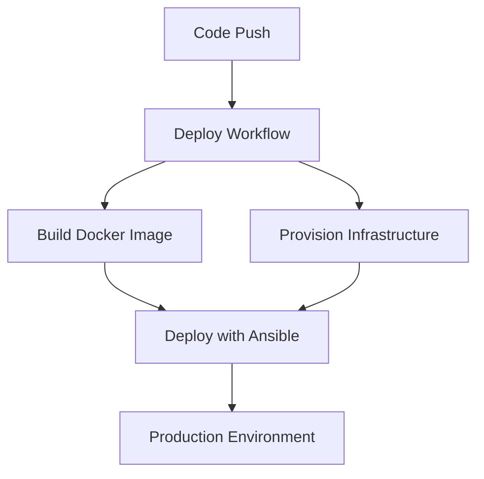

# GitHub Actions Workflows

This directory contains CI/CD workflows for automated testing, building, and deployment of the Atlas application.

## Workflow Files

### `workflows/deploy.yml`
**Purpose**: Complete CI/CD pipeline for production deployment

**Trigger**: 
- Push to `feat/release` branch (temporarily, should be `main`)
- Manual dispatch via GitHub UI

**Jobs**:
1. **Docker Job**: 
   - Builds application Docker image using `docker/web.Dockerfile`
   - Pushes to DigitalOcean Container Registry
   - Uses GitHub Actions cache for faster builds
   - Injects environment secrets as `.env.local`
   - Tags images with version for deployment tracking

2. **Terraform Job**:
   - Provisions infrastructure using OpenTofu
   - Applies infrastructure changes automatically
   - Uses S3 backend for state management

3. **Ansible Job**:
   - Configures servers and deploys application
   - Depends on Docker and Terraform jobs
   - Creates dynamic inventory from Terraform output
   - Sets up SSH keys and runs Ansible playbook
   - Deploys environment-specific configurations (.env.web)
   - Manages SSL certificate provisioning via nginx-certbot

**Environment Variables**:
- `DIGITALOCEAN_TOKEN`: DigitalOcean API access
- `SPACES_*`: DigitalOcean Spaces (S3-compatible) credentials
- `AWS_*`: AWS credentials for Terraform state storage
- `SSH_PRIVATE_KEY`: Server access key
- `ENV_WEB`: Application environment variables for production
- `ATLAS_WEB_VERSION`: Docker image version for deployment tracking
- `CERTBOT_EMAIL`: SSL certificate contact email

### `workflows/plan-infra.yml`
**Purpose**: Infrastructure change planning for pull requests

**Status**: Currently disabled (triggers on non-existent branch)

**Features**:
- Runs `terraform plan` on pull requests
- Posts plan output as PR comment
- Validates Terraform configuration
- Helps review infrastructure changes before merge

### `workflows/code-validation.yml`
**Purpose**: Code quality checks (referenced but not detailed in provided files)

**Features**: Likely includes linting, type checking, and testing

### Supporting Files

#### `workflows/pnpm-install/action.yml`
**Purpose**: Reusable action for pnpm installation and caching

#### `pull_request_template.md`
**Purpose**: Template for consistent pull request descriptions

#### `dependabot.yml`
**Purpose**: Automated dependency updates configuration

## Deployment Flow

## Security Considerations

- All sensitive data stored in GitHub Secrets
- SSH keys used for server access
- Registry authentication for Docker pushes
- Separate environment configurations per branch
- Restricted workflow permissions
- SSL/TLS certificates automatically managed
- Environment-specific secret injection (.env.web)

## Configuration Notes

- **OpenTofu**: Uses OpenTofu instead of Terraform for licensing reasons
- **Branch Strategy**: Currently using `feat/release` for testing
- **Environment**: Hardcoded to `main` environment (should be dynamic)
- **Concurrency**: Prevents multiple deployments from running simultaneously

## Local Development

To test workflows locally:
1. Use `act` tool for GitHub Actions simulation
2. Set up required environment variables
3. Ensure Docker and necessary tools are installed
